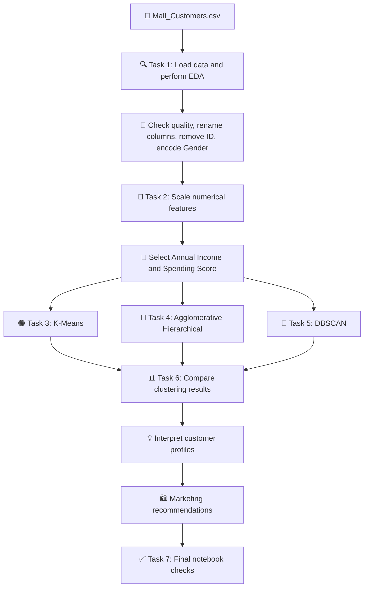
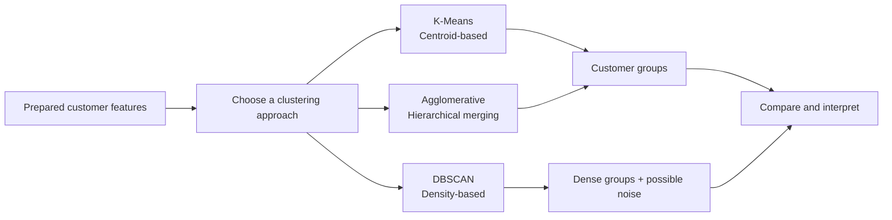

# 🛍️ Mall Customer Segmentation
### Unsupervised Learning | Practical Report 1

<p align="center">
  <strong>Discovering customer groups through K-Means, Agglomerative Hierarchical Clustering, and DBSCAN</strong>
</p>

<p align="center">
  
  
  
  
</p>

---

## 👋 About this project

Hi, I'm **Dushyant V**. This project is my practical exploration of **unsupervised machine learning** using a Mall Customer Segmentation dataset.

The question I wanted to explore was straightforward:

> **Can we identify groups of customers with similar income and spending behaviour, even when we are not given predefined customer categories?**

To investigate this, I explored the data, prepared the features, and compared three clustering approaches:

- **K-Means** — groups customers around cluster centroids.
- **Agglomerative Hierarchical Clustering** — builds a hierarchy by progressively merging groups.
- **DBSCAN** — identifies dense groups and can flag observations that do not fit into those groups as noise.

The aim was not just to produce clusters. I also wanted to understand what the groups might mean to a mall's marketing team and how those findings could support more relevant customer engagement.

---

## 📌 Table of contents

- [🎯 Project objectives](#-project-objectives)
- [📂 Dataset overview](#-dataset-overview)
- [🧰 Tools and libraries](#-tools-and-libraries)
- [🗺️ Project workflow](#️-project-workflow)
- [📓 Notebook walkthrough](#-notebook-walkthrough)
- [💻 Example code](#-example-code)
- [📊 Results at a glance](#-results-at-a-glance)
- [🧠 Business interpretation](#-business-interpretation)
- [⚙️ How to run the project](#️-how-to-run-the-project)
- [📁 Repository structure](#-repository-structure)
- [🔎 Notes and limitations](#-notes-and-limitations)
- [🙋 Author](#-author)

---

## 🎯 Project objectives

The project follows the practical assignment's seven-part structure:

1. **Exploratory Data Analysis (EDA):** inspect the dataset, check data quality, prepare columns, and explore distributions and relationships.
2. **Feature Scaling and Selection:** apply `StandardScaler` to the numerical features and create a two-feature dataset for the main visual clustering analysis.
3. **K-Means Clustering:** use the Elbow Method and Silhouette Score to examine the number of clusters, fit the model, and profile the resulting groups.
4. **Agglomerative Hierarchical Clustering:** build a Ward-linkage dendrogram, choose a cluster count, and compare the results with K-Means.
5. **DBSCAN Clustering:** inspect a 4-nearest-neighbour distance plot, test parameter combinations, and identify noise points.
6. **Algorithm Comparison and Business Insights:** compare the three approaches using visualisations and internal evaluation metrics, then translate the findings into marketing ideas.
7. **Notebook Quality and Submission:** organise the analysis and check that the notebook can be run from beginning to end.

---

## 📂 Dataset overview

The project uses `Mall_Customers.csv`.

| Detail | Description |
|---|---|
| Records | **200 customers** |
| Original columns | **5** |
| Missing values | **0** |
| Duplicate rows | **0** |
| Main clustering features | Annual Income and Spending Score |

### Original columns

| Column | Meaning | Use in this project |
|---|---|---|
| `CustomerID` | Customer identifier | Removed before modelling because it is not a behaviour feature |
| `Gender` | Customer gender | Encoded numerically for the prepared dataset |
| `Age` | Customer age | Used in EDA and cluster profiling |
| `Annual Income (k$)` | Annual income in thousands of dollars | Main clustering feature |
| `Spending Score (1-100)` | Spending score on a 1–100 scale | Main clustering feature |

### Preparation decisions

- Removed `CustomerID` from the modelling dataframe because an identifier does not describe customer behaviour.
- Renamed the income and spending columns to `Annual_Income` and `Spending_Score` for easier use in Python.
- Encoded `Gender` using `LabelEncoder`.
- Checked missing values and duplicate rows before modelling.
- Applied `StandardScaler` to `Age`, `Annual_Income`, and `Spending_Score`.
- Created `df_2f` with `Annual_Income` and `Spending_Score` for the main two-dimensional clustering analysis and visualisations.

---

## 🧰 Tools and libraries

The notebook uses the following Python tools:

| Tool / library | How it is used |
|---|---|
| **Python** | Main programming language |
| **Pandas** | Loading, cleaning, transforming, and profiling tabular data |
| **NumPy** | Numerical operations |
| **Matplotlib** | Plot creation and customisation |
| **Seaborn** | Statistical visualisations |
| **Scikit-learn** | Scaling, encoding, clustering, and evaluation metrics |
| **SciPy** | Hierarchical linkage and dendrogram |
| **Jupyter Notebook** | Interactive project environment |

---

## 🗺️ Project workflow

The workflow below summarises how I approached the analysis, from the raw CSV file through to the business interpretation.



### How the three algorithms approach the problem



---

## 📓 Notebook walkthrough

The complete implementation and outputs are in **[`UL_PR1.ipynb`](./UL_PR1.ipynb)**.

| Notebook task | What happens | Main outputs |
|---|---|---|
| Setup | Import libraries and configure plot styling | Ready-to-use analysis environment |
| **Task 1 — EDA** | Inspect, clean, encode, and explore the data | Data preview, `info()`, descriptive statistics, missing-value and duplicate checks, histograms, pairplot, heatmap |
| **Task 2 — Scaling** | Standardise numerical features and select two features | `df_scaled` and `df_2f` |
| **Task 3 — K-Means** | Inspect candidate cluster counts, fit the final model, and profile groups | Elbow plot, Silhouette plot, cluster scatter plot, centroids, profile table |
| **Task 4 — Hierarchical** | Use Ward linkage and fit Agglomerative Clustering | Dendrogram, cut line, scatter plot, profile table, side-by-side comparison |
| **Task 5 — DBSCAN** | Estimate and test density parameters | 4-NN distance plot, parameter grid, final cluster plot, noise-point count |
| **Task 6 — Comparison** | Compare the three methods and interpret their results | Three-panel comparison, metric table, marketing actions |
| **Task 7 — Quality checks** | Review final dataframe and notebook checklist | Final row count, columns, missing-value count, and cluster counts |

---

## 💻 Example code

The following snippets are short examples from the workflow in the notebook. The notebook remains the source for the full, executed analysis.

### 1. Load and inspect the data

```python
import pandas as pd

df = pd.read_csv("Mall_Customers.csv")

display(df.head())
df.info()
display(df.describe())

print("Missing values:")
print(df.isnull().sum())

print("Duplicate rows:", df.duplicated().sum())
```

**Why this matters:** Before modelling, I need to understand the shape of the dataset, the data types, the numerical ranges, and whether any data-quality issues need attention.

### 2. Prepare the features

```python
from sklearn.preprocessing import LabelEncoder

df = df.rename(columns={
    "Annual Income (k$)": "Annual_Income",
    "Spending Score (1-100)": "Spending_Score"
})

df = df.drop(columns=["CustomerID"])

encoder = LabelEncoder()
df["Gender"] = encoder.fit_transform(df["Gender"])
```

**Why this matters:** Clear column names make the code easier to read. The customer identifier is removed from modelling, and Gender is encoded numerically.

### 3. Scale numerical features and select two features

```python
from sklearn.preprocessing import StandardScaler

scaler = StandardScaler()

scaled_numeric = scaler.fit_transform(
    df[["Age", "Annual_Income", "Spending_Score"]]
)

df_scaled = pd.DataFrame(
    scaled_numeric,
    columns=["Age", "Annual_Income", "Spending_Score"]
)

df_scaled["Gender"] = df["Gender"].values

df_2f = df[["Annual_Income", "Spending_Score"]].copy()
```

**Why this matters:** Scaling helps prevent a feature's numerical range from dominating distance calculations. The two-feature dataframe supports the main income-versus-spending visualisations.

### 4. Use the Elbow Method with K-Means

```python
from sklearn.cluster import KMeans

inertias = []

for k in range(1, 11):
    model = KMeans(
        n_clusters=k,
        random_state=42,
        n_init=10
    )
    model.fit(df_2f)
    inertias.append(model.inertia_)
```

**Why this matters:** Inertia measures the within-cluster sum of squared distances to the cluster centres. The Elbow Method helps inspect where adding more clusters starts to give smaller improvements.

### 5. Fit the final K-Means model

```python
chosen_k = 5

kmeans = KMeans(
    n_clusters=chosen_k,
    random_state=42,
    n_init=10
)

df["KMeans_Cluster"] = kmeans.fit_predict(df_2f)
```

**Why this matters:** The notebook uses five clusters for the final K-Means analysis, then profiles the groups using the original feature units so the results are easier to interpret.

### 6. Fit Agglomerative Hierarchical Clustering

```python
from sklearn.cluster import AgglomerativeClustering

hierarchical = AgglomerativeClustering(
    n_clusters=5,
    linkage="ward"
)

df["Hier_Cluster"] = hierarchical.fit_predict(df_2f)
```

**Why this matters:** Agglomerative clustering starts with individual observations and progressively merges groups. Ward linkage chooses merges that minimise the increase in within-cluster variance.

### 7. Fit DBSCAN

```python
from sklearn.cluster import DBSCAN

dbscan = DBSCAN(
    eps=0.5,
    min_samples=3
)

df["DBSCAN_Cluster"] = dbscan.fit_predict(df_2f)

noise_points = (df["DBSCAN_Cluster"] == -1).sum()
print("Noise points:", noise_points)
```

**Why this matters:** DBSCAN identifies dense regions without requiring the number of clusters to be specified in advance. A label of `-1` indicates a noise point.

---

## 📊 Results at a glance

The following values are from the executed notebook.

### Clustering summary

| Algorithm | Clusters identified | Silhouette Score | Davies–Bouldin Index | Calinski–Harabasz Index |
|---|---:|---:|---:|---:|
| **K-Means** | 5 | **0.555** | **0.572** | **248.649** |
| Agglomerative Hierarchical | 5 | 0.554 | 0.578 | 244.410 |
| DBSCAN | 2 | 0.389 | 0.796 | 87.618 |

> **How to read these metrics:** A higher Silhouette Score is generally preferred. A lower Davies–Bouldin Index is generally preferred. A higher Calinski–Harabasz Index is generally preferred. These internal metrics are useful for comparison, but they do not replace visual inspection and business interpretation.

### DBSCAN parameter result

The selected DBSCAN configuration in the notebook is:

| Parameter | Selected value |
|---|---:|
| `eps` | `0.5` |
| `min_samples` | `3` |
| Clusters found (excluding noise) | **2** |
| Noise points | **7** |
| Silhouette Score (excluding noise) | **0.389** |

The notebook tests multiple `eps` and `min_samples` combinations before selecting the final configuration. DBSCAN's result is interpreted differently from K-Means and Hierarchical clustering because it can leave observations unassigned as noise.

### What stood out to me

- K-Means and Agglomerative Hierarchical Clustering produced very close Silhouette Scores in this analysis.
- K-Means had the highest Silhouette Score among the three reported results.
- DBSCAN identified two dense clusters and seven noise points with the selected parameters.
- A good clustering result should be judged by its metric scores **and** whether its groups are understandable and useful for the intended business question.

---

## 🧠 Business interpretation

The K-Means cluster profiles are used as the starting point for the marketing discussion. The notebook assigns human-readable segment names using the income and spending averages, rather than treating cluster IDs as meaningful labels.

| Customer behaviour | Possible marketing response |
|---|---|
| High income, high spending | Loyalty rewards, premium experiences, and early access to offers |
| Low income, high spending | Value bundles and affordable promotions |
| High income, low spending | Premium product discovery and personalised offers |
| Low income, low spending | Smaller incentives to encourage more visits |

These are **suggested actions**, not proven outcomes. The dataset describes customer attributes and spending scores; it does not measure whether a particular campaign would increase sales. A business would need to test campaigns and measure the results before deciding which actions work best.

### The practical takeaway

Customer segmentation can help a marketing team move away from a one-size-fits-all approach. Instead, the team can start with groups that have different income and spending patterns and develop more relevant ways to engage them.

---

## ⚙️ How to run the project

### 1. Clone or download this repository

```bash
git clone <your-repository-url>
cd <your-repository-folder>
```

Replace the placeholders with your actual GitHub repository URL and folder name.

### 2. Install the libraries

The notebook uses common data analysis and machine learning libraries. If they are not already installed, run:

```bash
python -m pip install numpy pandas matplotlib seaborn scikit-learn scipy jupyter notebook
```

### 3. Keep the dataset beside the notebook

Make sure these two files are in the same directory:

```text
Mall_Customers.csv
UL_PR1.ipynb
```

The notebook loads the CSV using a relative path:

```python
df = pd.read_csv("Mall_Customers.csv")
```

### 4. Start Jupyter Notebook

```bash
jupyter notebook
```

Open `UL_PR1.ipynb` in the browser.

### 5. Run the notebook from beginning to end

In Jupyter Notebook:

1. Open the notebook.
2. Select **Kernel → Restart Kernel**.
3. Select **Run → Run All Cells**.
4. Wait for the plots, tables, and outputs to finish.
5. Review the final quality-check section.

Running from a fresh kernel helps confirm that the notebook does not depend on variables left over from an earlier session.

---

## 📁 Repository structure

A clean repository for this project can use the following layout:

```text
Mall-Customer-Segmentation/
│
├── UL_PR1.ipynb
├── Mall_Customers.csv
├── README.md
│
├── screenshots/
│   ├── eda_distributions.png
│   ├── pairplot.png
│   ├── correlation_heatmap.png
│   ├── elbow_method.png
│   ├── silhouette_scores.png
│   ├── kmeans_clusters.png
│   ├── hierarchical_dendrogram.png
│   ├── dbscan_kdistance.png
│   ├── dbscan_clusters.png
│   └── algorithm_comparison.png
│
└── video/
    └── project_walkthrough.mp4
```

The `screenshots/` and `video/` folders are intended for the visual evidence and presentation associated with the project. Add the files you actually create; do not leave empty placeholder files in the repository.

---

## 🔎 Notes and limitations

A few points are important when interpreting this work:

- **Unsupervised learning does not use predefined target labels.** The algorithms identify structure from the selected input features.
- **Cluster IDs are arbitrary.** Cluster `0` is not automatically better, more valuable, or more important than cluster `1`.
- **The main clustering visualisations use two features.** This makes the segments easy to display, but it does not capture every possible customer characteristic.
- **DBSCAN depends on its density parameters.** Different `eps` and `min_samples` values can produce different numbers of clusters and noise points.
- **Evaluation scores are not the whole story.** Visual separation, cluster profiles, stability, and the intended use case also matter.
- **Marketing recommendations are hypotheses.** They should be tested with real campaign data before being treated as proven business outcomes.

---

## 🙋 Author

**Dushyant V**  
Unsupervised Learning — Practical Report 1  
Project: Mall Customer Segmentation

This project represents my practical work exploring data preparation, exploratory analysis, clustering algorithms, model evaluation, and business interpretation using Python.

---

## ⭐ Thanks for visiting

Thank you for taking the time to explore my project!

If you review the notebook, I hope the combination of code, visualisations, and plain-language interpretation makes the workflow easy to follow—not just what I ran, but why I ran it and what I learned from the results.
